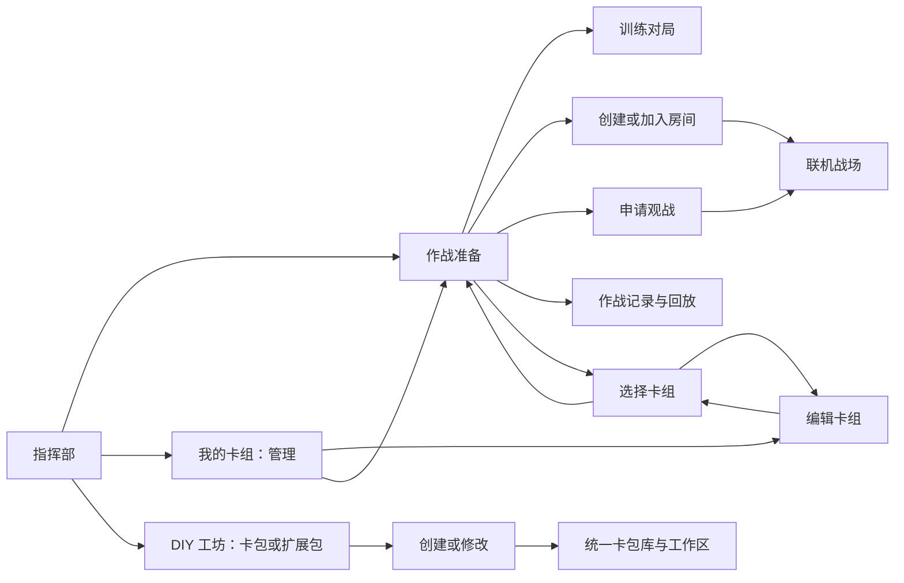

# 页面职责与导航收敛（2026-10-23）

本轮基于前端 `7cdf123` 开始修改，引擎本地基线为 `a25466c`。只修改前端仓库，不修改引擎源码，不推送或导出发行包。

## 当前页面关系

### 作战与卡组

- 首页、卡组库和卡组编辑器均先进入准备页，普通开战操作由准备页发出。工坊的单卡试打继续保留专用入口。
- 准备页保留训练／好友对战模式；选择卡组后回到原模式，编辑当前卡组直接进入对应编辑器。
- 卡组库区分管理与选择任务：选择模式显示“确认卡组，返回准备”，可取消返回；管理模式保留复制、导入、导出和删除。
- 卡组编辑器离开时可保存、放弃或继续编辑。取消离开不改变当前编辑上下文。
- 选择卡组过程中保留待加入地址，返回后显示目标并提供“取消加入”，切换训练模式清除加入任务。
- “返回战场”统一依据当前 feed，支持训练、联机、观战、回放；准备页也有继续当前作战入口。新作战不会静默替换当前会话。

### 房间

- 房间发现只在准备页展示和监听。好友模式中央显示房间列表，地址加入／观战共用连接弹窗；满房仍可观战。
- 房间页只处理当前房间：邀请、入场申请、双方状态、电脑对手、开局和离开。删除房间页的另一份大厅、手填地址与未开放 Agent 入口；电脑对手只从对手位置添加。
- 连接地址、房间标识和卡池诊断放入“连接详情”。双方状态使用卡组封面；仅显示本端真实卡组，对手使用中性卡背。
- 从房间切到战场保留连接；从房间返回准备页或侧栏页面，等待关闭连接与服务器。构建、加入、重连及首帧回调检查会话代次，避免离开后旧任务重新进入战场。
- 产品入口不再因卡组不兼容而自动换成另一副牌。自动组牌仅供显式验证夹具使用。

### 工坊

- 首页两张抉择卡及其动画保留。“修改”与“我的卡包”共用一份列表，按全部／卡包／扩展包筛选；启停、导出和草稿处理附在所选卡包下。
- 创建入口统一：新卡包及以原生包为基础的新扩展包进入原生制作流程；扩展归属写入前端展示元数据。已有兼容卡包继续通过原适配层读写，保留卡号、效果和草稿。
- 卡包信息在工作区编辑，不再借“重新选择卡包”完成改名。
- 普通效果编辑以图形规则为主。卡牌旧结构和编译结果放在“兼容工具”；旧词条可进入相同图形规则编辑器，参数与主动技能仍可编辑。已有程序不会在普通保存时被清除，切换编排方式前明确提示。
- 修复词条库嵌套弹窗的父窗口归属和内容溢出，使用可滚动内容区。

## 本轮验证

日志位于前端 `artifacts/navigation-*.log`，画面位于短路径工作副本 `H:/g/kards/artifacts/navigation-20261023` 和 `artifacts/menu/room-*.png`。

| 验证 | 结果 |
| --- | --- |
| UI 构建 | 通过，0 错误；存在既有警告 |
| `--verify-navigation`，原生窗口 1600×900／1280×720 | 通过；覆盖准备入口、模式保留、待加入地址、编辑返回、未保存取消、训练／回放恢复、统一卡包库、词条图形保存、原生卡包／扩展包创建、离开时取消建房；1600×900 另覆盖观战被拒后从界面重新申请 |
| 工坊／原生卡包／回放相关单测 | 57 项通过，0 失败，0 跳过 |
| `--verify-menu`，原生窗口 | 通过；卡组入口先到准备页后才开局，隐藏战场选靶和恢复对局仍正常 |
| `--verify-workshop-routes` | 通过；20 个卡包入口，覆盖源卡、自建、机制包、扩展、原生与草稿恢复，用户原库哈希保持不变 |
| `--verify-native-workshop`，原生窗口 | 通过；包括 ZIP、卡图、自定义国家、三种母版、效果编辑、保存与应用 |
| `--verify-room` | 通过；电脑对手、实际换牌、卡图与回合返回 |
| `--verify-room-join` | 通过；待批准加入与双方不同视野 |
| `--verify-room-discovery` | 通过；准备页发现、地址加入、自建房过滤 |
| `--verify-room-reconnect` | 通过；房主与客人恢复连接，原对局保留 |
| `--verify-viewer-replay` | 通过；无座位观战、双视角、权限撤销、回放读写及控制 |
| `--verify-deck` | 通过；有效卡组直通，不兼容卡组阻止开房且不替换卡组 |

复验入口：`./tools/run.ps1 -VerifyNavigation`。验证使用隔离卡组和工坊目录，不修改玩家原始库。

本轮画面副本：`artifacts/ui-navigation-20261023/friends.png`、`workshop.png`、`room.png`、`effect-editor.png`。

## 验证边界

- 房间验证使用同机多客户端与环回网络，没有据此宣称跨机器或虚拟局域网已验收。
- 本轮不迁移旧兼容卡的存储格式，也不宣称它们因此获得原生联机准入。
- 未重跑完整战斗门禁；引擎移动类型契约等历史阻塞继续参见 `docs/engine/ENGINE_7F3AE35_IMPACT_20261022.md`。本轮通过的导航和房间探针不等于整局战斗全部通过。
