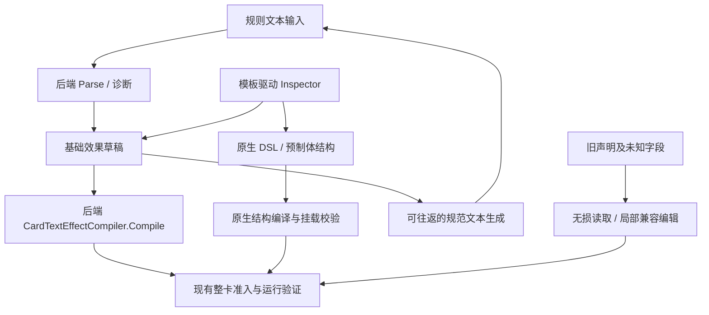

# DIY 后端同源解析与 Inspector 重设计实施方案

日期：2026-10-20  
状态：首批已开始实施；能力基线与组合编辑原型见 `DIY_INSPECTOR_COMPOSITION_PROGRESS_20261020.md`。以下为完整路线，不表示所有阶段均已完成。  
参考输入：`docs/design/DIY_PARSE_AND_INSPECTOR_REDESIGN.md`。保留该原文，本文件给出校正后的实施路线。  
已核对引擎 HEAD：`6d72eac`；UI 工作区包含尚未提交的母版、字体与其他改动，实施不得覆盖这些成果。

## 1. 建议采用的方向

**Inspector 同时重构界面和编辑逻辑：用通用组合表达效果，由后端约束合法性；新文本解析使用后端。不能只换皮，也不能把整个编辑器压缩到九个文本动作。**

本轮补充要求：现有 Inspector 即使由熟悉项目的人操作也难以理解。新设计必须降低操作门槛，同时避免为具体卡牌、特定兵种组合或非常具体的触发条件不断增加专用选项。“逻辑重构”指编辑状态、上下文、修改事务和参数组织，不是在 UI 重写规则执行逻辑。

1. 自动解析仍限定为受支持的 KARDS 规则语法，不承诺理解任意中文。新的文本解析入口不调用 V8，也不在 Godot 内再造规则解释器。
2. 区分「文本可表达」「原生结构可编辑」「可编译」「可用于实战」，各自给出真实状态。
3. 现有复杂效果、中文计数器、旧简易行、DesktopJson、原生预制体必须保留。文本能力收窄不能造成数据被覆盖或可编辑能力整体消失。
4. 双向同步只对经过往返验证的子集自动开启。不能无损生成文本的结构保留原始规则文字，并明确标记没有文本闭环。
5. 继续复用当前三类 Astral 母版及 PSD 字体排版；对局界面、伤害与胜负逻辑不在本次重设计范围内。

## 2. 对参考文档的必要修正

| 原文判断 | 当前代码证据 | 方案修正 |
| --- | --- | --- |
| DesktopNativeLowering 未覆盖字段会直接丢弃 | `DesktopNativeLowering.cs:15,35` 对未识别字段抛出 Gap；`OrcInspector.cs:21–25` 聚合原生问题 | 当前风险是适配覆盖不足与双链漂移；不能把未经证明的静默丢弃当作既成事实。对每项遗漏建立可复现样例。 |
| 后端文本可表达 9 op × 7 选靶 × 3 期限 | `CardTextEffectCompiler` 的校验词表如此，但 `Parse` 返回扁平动作，`Until` 总是空；单位要求“部署：” | 词表、文本语法、合法参数组合分别列目录。不能承诺所有组合都能由文本生成。 |
| 九个动作足够作为整个 Inspector 的模型 | 目前已有条件、额外动作、中文计数器、完整 DesktopJson 与 PrefabJson | 九动作仅是基础文本模式；高级结构继续用原生 DSL／预制体通道。 |
| 31 个模板就是 31 种可直接添加的时机 | `attack_basic.tpl.json` 含专用载荷与 `Initiate` 注入；不是普通 hook 替换 | 目录必须包括槽位、载荷、守卫、注入目标与 band，并逐项验证挂载资格。发现模板不等于可实战。 |
| 首行注释就是完整参数 schema | 21 个 op 文件包括 csx、needsCsx、nested；部分首行没有参数，`value` 等占位符也未完整出现在首行 | 注释仅提供标签线索；不能据此生成完整可写表单，更不能把未知结构默认当字符串。 |
| 按异常里的 op 名定位行 | 一条效果可有多个同名 op，且现有后端 Parse 只返回 null，没有片段坐标 | 需要稳定节点 ID、结构路径与后端 SourceSpan。不能通过字符串猜出唯一出错行。 |
| 逐字节一致就消除所有运行问题 | 包管道本身仍需实际挂载与执行验证 | 相同输入参数下比较序列化结果，同时验证选靶、顺序、触发次数与实际结果。 |
| 旧 DesktopJson 全部改成只读 | 现有图形检查器已经能编辑一部分旧声明 | 保留已验证的编辑面；不支持的节点或字段局部只读，整份原始声明无损保存。 |

**另一个必须先验证的后端风险**：文本正则允许“1个敌方单位”和“1 个敌方单位”，但 `Side()` 只显式匹配带空格的形式，其他形式落到默认 `anyUnit`。这是静态阅读发现的语义风险，开工时须用后端测试确认，不能以“与后端输出一致”掩盖错误选靶。

## 3. 能力分层与数据真源

| 编辑来源 | 权威数据 | 文本能力 | 保存与执行 |
| --- | --- | --- | --- |
| 后端基础文本 | 后端 Parse 产生的草稿序列；桥只做无损字段映射 | 可解析子集可联动生成 | 使用后端 CardTextEffectCompiler.Compile；通过现有整卡准入才可实战 |
| 原生结构 | 原生模板、槽位、DSL 参数／预制体声明 | 可完整生成时联动；否则显示“结构超出文本表达范围” | 走原生编译及挂载验证，不强行塞进九动作草稿 |
| 旧 DesktopJson | 完整原始 JSON | 不自动重解析；按能力提供转换预览 | 保留现有已验证适配和原有限制，不暗中退回 V8 新文本解析 |
| 原生 PrefabJson／未知结构 | 完整原始 JSON 与来源信息 | 原卡面说明照常显示 | 保留只读未知部分及原有准入状态 |

### 3.1 存储调整原则

- 尽量复用 `DiyCardDraft.Effects`、`OrcEffects`，不引入第二套有独立规则语义的前端 IR。
- 拟增加可选的 `EffectSchemaVersion`、`EffectSource`、`TextSyncMode`。旧记录没有新字段时按旧版来源解释，不批量重写文件。
- 基础文本模式映射后端草稿字段，但必须显式记录来源，避免被现有优先级再次编译到旧桥内模板。
- 原生高级结构、完整 JSON 与未知字段保持原样；UI 节点 ID 用来定位和撤销，不改变后端 stableKey、hook 或引用身份。
- 来源迁移后只有一个效果结构真源。卡面说明、生成文本和正在输入的临时文本分别管理，不能靠“哪个字段非空”决定执行哪个版本。
- 本轮不改资产 GUID、SourceCardId、卡组引用、正式／测试域、sidecar 或 lock。若后续直接写原生资产，应接后端资产编辑契约，不能由新 Inspector 私自生成这些身份或更新 lock。

## 4. 需要后端提供的最小契约

以下是**拟议接口能力，当前尚不能视为已经存在**。包与资产身份元数据也不等同于表单参数 schema。

| 能力 | 当前限制 | 建议输出 |
| --- | --- | --- |
| 带定位的文本解析 | Parse 返回草稿或 null，无失败位置 | ParseDetailed：草稿、SourceSpan、错误代码、建议语法；旧 Parse 作为兼容包装，共用同一解析实现 |
| 编译诊断定位 | 异常主要是字符串 | effect/node 路径、op 索引／ID、参数路径、阶段、原始诊断；桥再映射到编辑节点 |
| 动作描述目录 | OpTemplateCatalog 可枚举／渲染模板，未提供完整表单类型契约 | 参数类型、必填性、默认值、合法范围、枚举、结构类型、可空性、依赖／显隐条件、版本和来源 |
| 触发描述目录 | JSON 有模板、slot、hook／inject 信息，缺统一编辑及能力描述 | 槽位、载荷类型、守卫、适用卡类、注入目标／band、可编译与可挂载能力 |
| 上下文与组合类型 | 当前表单有通用判断，但引用、属性及比较选项仍多由前端词表拼出 | 当前时机提供的对象／值、引用有效范围、属性类型、查询／表达式／比较的合法组合；不支持的组合返回明确原因 |
| 文本规范生成 | 当前只有 Parse／Compile | 优先由后端导出词汇／生成能力；若暂由桥实现有限 OpTextWriter，必须只生成后端已确认语法并完成全部往返测试 |

在 ParseDetailed 未提供前，前端只能如实标记整段文本未被后端接受。**不在前端增加分句解析器来伪造精确定位。**

后端 schema 未提供前，可用一份版本化的声明式编辑目录作为过渡，但必须逐项对照原生 DTO／模板占位符并记录版本。它是控件元数据，不定义玩法；未知字段保持只读。新增具有已有字段类型的动作可只改目录；新增全新结构类型仍需要对应控件，不能承诺永远零 UI 代码。

## 5. Inspector 交互方案

### 5.1 当前难点与重构边界

当前 `NativeEffectInspector.Friendly.cs` 已有全部／任一／取反／比较等通用控件，不需要再造一套平行的“简单规则”。问题是通用结构仍直接暴露为“左边的值”、底层引用和深层参数，同时夹杂专用条件分支；切换部分判断类型还会整段替换节点。`DiyEffectEditorScreen.cs` 则有按 `OwnerControlsType` 显示兵种、比较与数量的专属分支。新设计需要把已有能力组织成一致操作，而不是删除复杂效果，或再加一层同义表单。

普通编辑路径不要求知道 JSON 路径、`behavior:…`、hook、guard 或 band。不采用默认展开的结构树或连线画布。高级原文仍是同一份声明的检查与兼容入口，不成为完成常见编辑的必经之路。

### 5.2 用户面对的主流程

默认只显示“**何时发生 → 做什么 → 作用于谁**”，按动作显示必需的数值；“满足条件才执行”“次数与期限”按需添加。对象和数值使用同一套选择器，不因出现在触发器、动作或条件里而换一套术语。

- **左侧效果列表：** 每条显示可读摘要、未完成／出错标记；支持添加、复制、删除和排序，提供键盘及上下移动操作。
- **中间效果编辑：** 时机、可选前提、有序动作。每段先给出可读的一行，点击其中的对象、属性或数值进入局部编辑；一次只展开正在编辑的层次，保留上级摘要与返回位置。
- **右侧预览：** 复用当前 CardFace；卡面文字与编辑摘要分开显示。诊断贴近对应输入，汇总处可跳转。原始声明和编译产物放进高级页。
- **窄窗口：** 预览使用页签／抽屉，优先保证参数区可读，不将三栏同时压扁。1280×720 与 1600×900 均验收。

新效果的未填项显示“选择时机／动作／对象”，保存为未完成草稿；不能默默补成“本单位攻击力 ≥ 1”或“1 ≥ 1”等看似合法的条件。未设置前提明确显示“无额外条件”；空条件组作为编辑中的占位，不擅自解释为可运行的恒真／恒假规则。

### 5.3 通用组合模型：具体规则由组合产生

下表是编辑视图的组成方式，**不是新增前端执行 IR**。存储继续复用第 3 节的权威声明，通过版本化适配器往返。

| 组成 | 用户如何填写 | 约束与复用 |
| --- | --- | --- |
| 时机 | 先选事件类别／事件，再选后端允许的阶段、事件主体及关系 | 将事件与主体过滤分开；不把“某类友方单位在某条件下受伤”等笛卡尔积列成独立触发器 |
| 对象 | 选择来源，例如当前卡牌、事件携带对象、区域查询或已有结果；再按需筛选 | 只显示该上下文存在的引用，说明“事件中的谁”；查询中的“当前候选对象”只在该查询内有效 |
| 查询与选择 | 区域、归属、属性筛选、选择方式及数量逐步组合 | 多处复用；数量统计与实际选靶区分，不能为了计数隐式随机选取目标 |
| 取值 | 常数、对象属性、查询结果数量、计数器；需要时展开后端支持的计算 | 标明类型与来源；属性、比较符和运算符由类型约束，不能将任意字符串当作数字 |
| 条件 | 选择“比较／是否存在”，填写对象或取值与关系；按需添加“全部满足／任一满足／取反” | 使用相同对象、查询和取值控件；简单条件显示一行，嵌套组显示清晰边界与父级关系 |
| 动作 | 按用途查找后端动作，填写对象、数值及该动作必需参数 | 有序列表；分支、重复、结果引用只有在后端契约支持且上下文有效时开放 |
| 次数与期限 | 可选的触发次数限制、作用范围及持续期限 | 与条件分区，不通过文案近似互相转换；只开放有真实运行支持的选项 |

例如“某个查询得到的对象数量 ≥ 某个值”，由查询、计数、比较和值四部分组成。更换区域、归属、属性或比较值仍复用这些部分；不会增加一个“控制特定兵种数量”专用编辑器。示例仅用于说明组合方式，不作为固定菜单或新增后端能力承诺。

“通用”也不等于所有字段都让用户自由拼接。原子事件、属性、动作与对象类型属于后端领域契约；合法的领域原语可以有专属参数，**不能把每个完整玩法句子做成新原语或 UI 特判**。新参数类型可能需要新控件；已有类型的新组合应通过目录与适配完成。

### 5.4 保持语义位置，避免同名“条件”混用

| 用户所处位置 | 含义 | 编辑规则 |
| --- | --- | --- |
| 时机中的事件主体／范围 | 哪些事件允许进入该效果 | 对照后端事件守卫；不任意搬到动作前提 |
| 效果前提 | 本次触发是否继续执行 | 对照实际求值时点与上下文 |
| 对象筛选 | 哪些候选对象进入查询结果或选靶集合 | 属性引用绑定候选对象，不绑定事件主体或当前卡牌 |
| 动作自己的执行条件 | 某一步是否执行，或执行哪一分支 | 仅在后端支持时显示，保留与前序动作的顺序关系 |

这些位置共用条件控件，但不自动互换语义。修改时机导致事件引用失效时，保留原值并在原位置说明原因，提供重新绑定；不自动换成“本单位”。不允许为适配通用 UI 而静默改变先筛选还是后选择、先检查条件还是先执行动作。

### 5.5 编辑逻辑与状态一起重构

1. **一份文档，多种视图。** 保留 `InspectorDocument` 的完整声明和未知字段；将当前各处控件直接拼 JSON 的行为收敛到明确的编辑命令和声明适配器。基础模式与高级页读写同一真源，不维护两套独立规则。
2. **一次操作，一个事务。** 添加条件、切换类型、替换时机、复制节点、更新文字等经事务提交。保留撤销／重做，连续文本输入合并为合理步骤；取消局部编辑不写入文档。当前逐次 `Set/Append/Remove` 的快照机制需补事务边界。
3. **类型变化有兼容映射。** 保留可兼容的参数；不兼容部分先保留在可恢复的修改前状态，显示受影响项后由显式应用完成替换。不以切换下拉框为由直接清空整个节点。
4. **结构身份与 UI 状态分离。** 选择、折叠、焦点和未提交输入按稳定编辑节点 ID 管理；排序／插入后重算 JSON 路径，不能继续把数组下标当身份。后端资产身份保持原样。
5. **按上下文提供选项。** 描述目录提供类型、字段角色和能力；适配器处理声明格式差异。控件不根据卡名、完整规则句子或某个组合条件决定显隐。后端校验负责玩法合法性，前端类型检查只帮助输入。
6. **摘要只负责解释。** 摘要由当前结构生成，能定位到编辑项；不将它再当自然语言解析入口，也不替代原卡规则文字。后端不支持文本往返时，仍可继续结构编辑。

### 5.6 参数、计数器与兼容能力

- 有范围的数值使用数值控件；可空值区分“不填”和 0。枚举与资源引用显示中文名并保留稳定 ID；缺失项不自动选第一项。
- 中文计数器保留独立管理入口，标明作用域；伤害／增益等处从通用取值入口引用。重命名通过同一事务更新已知引用；未知引用无法证明安全时明确报告。
- 未知节点／字段局部只读保留、可复制；已验证的旧结构仍可编辑。不要求用户把整份原文转换后才能修改其他正常字段。
- csx／needsCsx／nested 等特殊项单独说明能力；占位项不伪装成可用动作。能力分别标明“可编辑／只读保留”“可编译／编译失败”“可用于实战／仅草稿”。

### 5.7 不过拟合与易用性的验收

- 用设计期间未出现过、但由已有合法原语组成的条件与动作组合验收；完成编辑、保存重开和运行核对时，不新增专用条件类型、卡名判断或专属表单分支。
- 同一查询或值来源用于效果前提、对象筛选及动作参数时，复用控件与类型检查，同时正确绑定各自上下文。改变组合不能改变已有语义。
- 至少覆盖：无条件单动作、查询计数比较、全部／任一嵌套、事件对象引用、有序多动作、中文计数器引用、旧复杂效果的局部修改。样例必须以实际后端能力为准。
- 操作者可从空白效果完成上述受支持任务，并能从界面判断“什么时候、对谁、做什么、为何无法执行”；不以输入 JSON、记忆引擎 ID 或阅读长教程作为完成条件。
- 切换时机／类型、取消编辑、撤销、删除引用、排序和诊断跳转均验证。摘要必须随结构更新，不能出现显示和保存内容不一致。

## 6. 文本联动与旧卡转换

### 6.1 文本与结构联动

1. 用户输入文本时只更新临时输入及解析预览；解析失败保留原结构。
2. 用户执行“解析并替换／追加”后，原文、结构、来源和诊断作为一个事务提交；失败不写半份。
3. 对可往返的基础结构，Inspector 编辑后生成规范文本并更新 EffectText；结构与文字在同一个撤销步骤中恢复。
4. 生成后必须再次调用后端 Parse，并比较规范化草稿。顺序、对象、数量、期限或触发语义不一致就停止联动，保留上一次有效状态。
5. 含文本语法无法表达的条件、计数器、其他触发器等结构，不自动降级为九动作，不用概括性说明覆盖原规则文字。
6. 原文含别名或注释时先保留；首次因结构编辑生成规范文本，要显示“已按效果更新规则文本”及可撤销状态。

**当前后端 Parse 不读取期限文本**，因此不能为 turnEnd／nextOwnerTurnStart 强造一句“可解析”的话。可保留高级结构里的期限；文本联动须等待后端支持或明确关闭该条的联动。

### 6.2 旧卡迁移

- 打开旧卡不会自动转换或覆盖；保留其现有可用编辑面。
- “转换为后端基础效果”先生成候选副本，展示原始／转换后结构、卡面文字、能力变化和无法保留字段。
- 对可证明等价的简单子集提供一键转换；无法证明时仅允许另存候选草稿，不替换原卡。
- 明确应用转换后才写入新来源标记；保留可恢复的转换前快照，并验证原 ID、引用、卡图、母版和字段均不变。
- 不允许一个转换失败导致整个卡包或其他卡牌被重写。

## 7. 实施顺序与交付门槛

| 阶段 | 工作 | 必须交付的验收结果 |
| --- | --- | --- |
| **P0：基线与后端验证** | 固定引擎版本／资产指纹；建立旧存档、简单语句、复杂效果、反制、中文计数器样例；验证空格选靶、多 op 编译／实例化／执行、空文本与反制行为 | 能力矩阵和可复现问题清单。后端缺陷先列修复依赖，不以 UI 拆分 op 或静默换选靶掩盖 |
| **P1：交互原型与通用组合验证** | 按第 5 节制作可操作原型；用真实支持的普通和复杂声明走通对象、取值、条件、动作；校对编辑命令与上下文模型 | 能完成普通编辑；用未参与设计的组合验证不过拟合；明确所有后端缺口。原型不冒充已接实战的编辑器 |
| **P2：描述目录、文档与存储适配** | 枚举当前 21 op／31 触发资产；补类型／上下文目录、版本与合法组合；实现事务、节点身份、无损适配 | 目录无遗漏；未知字段往返不变；撤销与取消无半成品；新增已有类型的合法组合不增加专属表单 |
| **P3：Inspector 实装与同源文本链** | 以内部入口逐步接入新交互；基础文本接后端 Parse／Compile 与来源诊断；保留旧存档读取及已确认编辑能力 | 新文本不调用 V8；相同参数下与后端直接调用一致；真实编辑／保存重开通过第 5.7 节；后端缺口不由 UI 私自补规则 |
| **P4：文本生成与联动** | 基础子集生成器、Parse 往返、一次事务撤销；超集结构明确断开文本联动 | 对合法样例有 Parse(Generate(draft)) ≡ draft；无损子集即时回写，其余结构不被重写 |
| **P5：迁移与切换** | 旧卡转换预览、恢复快照、语法速查；入口切换与文档 | 旧卡／包保真，迁移可恢复；新链不隐式回退；完整 UI 与真实运行回归通过后再退役旧主入口 |

**首批工作调整为 P0＋P1：同时确定真实能力边界与可操作的新交互。** 不再以“只替换解析链”作为首批完成标准。通用组合通过后再接正式文档和持久化链路；暂不删除 727 行旧编辑器，也不将目录发现等同于可编辑／可实战。

## 8. 测试与验收清单

### 8.1 后端一致性与语义

- 固定相同参数时，桥调用结果与直接调用后端的快照序列化结果一致。测试固定 compileId／序列化器；不能比较不同生成 ID 后的字节并据此误报。
- 如需跨身份比较，只允许在明确的生成身份字段上规范化；不删除 hook、guard、选择器、条件、band、动作顺序等语义字段。
- 语义断言包括：友／敌选靶、所有／随机／选择、触发归属、动作顺序和次数、实际费用／牌数／属性变化。输出一致不替代这些断言。
- “1个／1 个”、多动作、重复同名动作、空白／未知文本、超范围参数、期限、反制都单列用例。
- 指令／反制无效果不能套用“单位白板合法”。当前文本编译器非 unit 使用 card.played，反制必须单独验证，不能因为母版正确就推定语义正确。

### 8.2 持久化与兼容

- 保存 → 重开 → 导出／导入：原始声明、节点顺序、计数器名和引用、未知字段、来源标记、人工规则文字保持正确。
- 诊断覆盖同名 op、多效果、排序后的定位，禁止按 op 名定位错误行。
- 效果、文本与来源一次撤销；转换中断／失败时原卡不变。
- 覆盖 Effects、OrcEffects、DesktopJson、PrefabJson、自带卡修改和内置卡修改。

### 8.3 UI 与真实流程

- 运行 `--verify-diy`、`--verify-workshop`、`--verify-ui`，新增 Inspector 专用交互探针。
- 1280×720、1600×900：键盘及鼠标编辑、长参数、长中文、诊断展开、计数器、选项缺失、预览均可使用。
- 保留当前母版与字体检查 `--capture-cardface`；对局组件与引擎源码按工作起点做范围对照。
- 在固定原生样例中实际挂载、触发和执行，再标记该项“可用于实战”。目录枚举、脚本编译和卡池可见都不是运行证明。
- 第 5.7 节的通用组合与易用性验收为入口切换的必要门槛；已有构建与 UI 探针通过不能替代这些操作验收。

本文件是实施方案，不表示上述新验收已执行或通过。

## 9. 本次核对的主要源码

| 位置 | 用途 |
| --- | --- |
| UI `OrcInspector.cs:42` | 当前 V8 新文本入口与逐 op 原生编译 |
| UI `DesktopNativeLowering.cs:15,35` | 完整字段检查及显式 Gap |
| UI `DiyEffectEditorScreen.cs:104,137` | 当前结构／文本关系与独立计数器页 |
| UI `NativeEffectInspector.Friendly.cs:176,292,442` | 当前时机／前提组织、专用原生条件分支及通用条件编辑器 |
| UI `InspectorDocument.cs` | 完整声明、逐次修改快照与当前词表／默认值；需要补事务和上下文编辑适配 |
| UI `OrcEffectEditing.cs:74` | 中文计数器动作所在的扩展编辑面 |
| UI `DiyInjectionCatalog.cs:21` | 当前仍按旧限制拒绝非空 band；需要与真实目标方案逐项对齐 |
| 引擎 `EffectParsing/CardTextEffectCompiler.cs:74,122,178,253,263` | Parse／Compile、期限、选靶与触发能力边界 |
| 引擎 `EffectParsing/Compilation/OpTemplateCatalog.cs:34,58,133` | 占位符校验、目录枚举与渲染；非完整 UI schema |
| 引擎 `Orc.Packages/PackageRegistrar.cs:543,551` | 卡包文本实际复用的后端入口 |
| 引擎 `Orc.Game/Cards/EffectSystem.cs:354` | 非空 band 随声明进入注入调用 |
| 引擎 `docs/资产元数据与后端编辑器/implementation.md` | 当前资产身份、sidecar、lock 与加载边界，不能与控件参数 schema 混为一谈 |

引擎路径前缀为 `H:/Working Folder/OrC-KSD-github/src/`；UI 路径前缀为本工程 `proto/bridge/Kards.Ui.OrcBridge/` 或 `proto/ui/screens/`。这些位置是本轮只读核对的依据；进入实施时应重新确认版本和文件内容。
