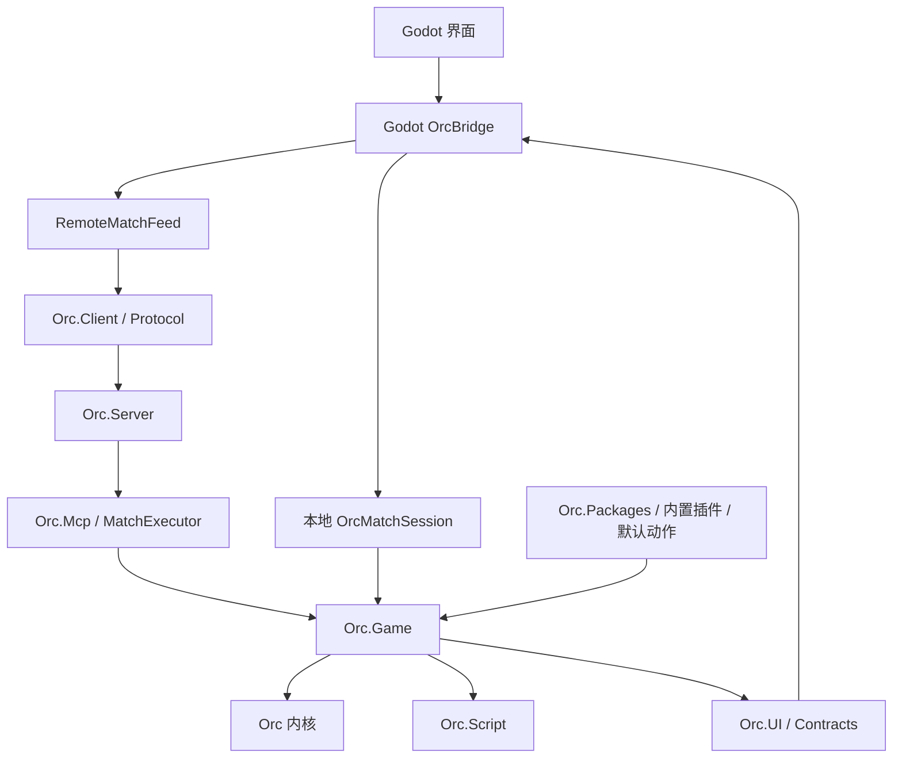

# OrC-KSD 引擎调研（2026-10-27）

## 1. 调研范围与结论

本报告以本地实际源码为依据，覆盖内核、KARDS 游戏层、效果创作链、选靶、包系统、服务端、AI、投影、Godot 桥接和测试。目的是判断“引擎实际能做什么、游戏接通了什么、后续应当改哪里”，不是重复旧交接的完成声明。

**总体判断：底层是一个具有事件编排、规则改写与动态脚本能力的卡牌引擎；当前 DIY 的主要瓶颈在多条创作表示之间的语义转换、交互接线和验收覆盖。与此同时，KARDS 游戏层确实存在固定规则和未接线机制，不能把所有问题都归给界面。**

| 对象 | 判断 |
| --- | --- |
| 通用内核 | 有触发器、事件总线、band、wrapper、判定器、上下文视图、安全引用、效果生命周期与事件流，扩展基础较完整 |
| 游戏层 | 已有完整的初始化、换牌、回合、资源、部署、指令、反制、指挥、伤害和终局链；不是任意卡牌游戏的开箱即用规则集 |
| 原生效果 | C# 效果、运行时 API、预制体、流程注入能覆盖远多于文字解析器的机制 |
| DIY 编辑器 | 当前动作词汇目录 161 项；现有测试固定为 57 项 Alpha、104 项 Preview。该数字是默认声明的适配分类，不是引擎能力百分比，也不是参数组合验收率 |
| 选靶 | 引擎明确区分无头查询与玩家交互；项目仍存在部分路径悄然退回无头选择的风险 |
| 联机 | 服务端执行规则，客户端通过 TCP/NDJSON RPC 接收投影和选择请求；已有卡包传输与对齐，不等于所有 DIY 表示都可无损跨端 |
| 双端 | 共用原生规则，但 JS 解析宿主、程序集装载和服务端生命周期不同，必须分别验收导出产物 |

### 证据等级

- **源码确认**：本轮直接读取实现、工程引用、现有测试代码得出的结论。
- **历史验证**：现有交接/验收文档记载的通过结果，本轮没有重新执行。
- **待运行验证**：从源码发现的可构造风险，需要用具体用例确定实际表现和影响范围。

本轮未修改游戏和引擎实现，未构建、未跑全量测试、未联网 fetch、未发版。报告不能用于宣称当前二进制全部通过验收，也不代表审阅了每一个 handler。

## 2. 当前现场：不能再以 alpha.5 发布时的源码认定现状

- Godot 主仓库 HEAD：`6af3ab5`，前一提交 `df0f984`，均晚于上次调研的 `8cfd7ea`。
- `VERSION` 仍为 `2.0.0-alpha.5`。因此“源码已补”与“公开安装包已包含”必须分开核对。
- 相邻引擎目录：`H:/Working Folder/OrC-KSD-github`。读取 `.git/HEAD` 和分支引用得到 main 指向 `4c238db58b3e9a61d22b9a9c5940010d15755742`，提交主题为部署候选池包含来源卡自身。
- 本轮部分引擎 Git 工作树检查被当前环境访问限制拒绝；没有修改权限设置。**分支引用只能证明提交标识，不能证明引擎工作区干净或源码全部等于该提交。** 具体结论以本轮读取到的文件内容为准。
- Godot 有其他进行中的未提交修改：ServerLauncher、Main.Mobile、Main、RoomScreen、run.ps1，以及新生命周期/进程验证文件。本轮保留它们，未把这些修改计为已发布功能。
- `docs/planning/HANDOFF_20261027.md` 记录 P2–P7 收口与 694/694 单测通过，这是历史记录，本轮未复跑。
- `docs/engine/ENGINE_INTEGRATION_BASELINE.md` 仍以 alpha.5 累积补丁开头，又保留多段标题为“当前”的旧基线。它适合追历史，不能单独作为当前唯一版本清单。

旧的 [alpha.5 重新排查交接](../planning/DEPLOY_TARGETING_ALPHA5_REOPEN_HANDOFF_20261025.md) 仍有历史价值，但其中“结构化基础选靶未转换、联机目标与空隙共用字段”的描述，已有后续针对性修补，不能原样当作当前缺陷清单。

## 3. 架构：15 个生产工程分别负责什么

依赖方向由当前 `.csproj` 核对。引擎生产工程目标为 .NET 8 / C# 12；Godot 主工程为 .NET 9。

| 工程 | 责任与边界 |
| --- | --- |
| Orc | 通用事件、触发器、效果、上下文、引用、编排与记录；不决定 KARDS 伤害和部署规则 |
| Orc.Script | Roslyn C# 脚本求值、入口委托绑定与缓存；依赖 Orc |
| Orc.UI.Contracts | 中立投影 DTO，避免界面直接依赖可变对局对象 |
| Orc.Game | Match、牌型、战线、资源、管理器、词条、选靶和效果 API；依赖内核、脚本和中立契约 |
| Orc.Packages | EngineHost、包发现/解析/激活、卡加载、运行期目录、编辑会话和资产身份 |
| Orc.Plugins.BuiltIn | 内置插件注册与资产装配；内置权限不等于第三方插件拥有同样内部 API |
| Orc.Foundation.Actions | 默认动作实现与注册，建立对局前必须正确装配 |
| Orc.UI | 游戏状态到中立界面契约的投影提供者 |
| Orc.Ai | AiPilot 与启发式策略，通过游戏操作网关行动 |
| Orc.Mcp | 协议无关工具服务、MatchExecutor、待决选择桥、创作/调试工具 |
| Orc.Protocol | RPC 契约、包引用与网络卡包归档等传输模型 |
| Orc.Client | 网络 RPC 客户端，主要依赖 Protocol |
| Orc.Server | 房间、座位、连接、串行执行、服务层与 AI 驱动 |
| Orc.Manager | 服务进程和资产管理，协调服务端启动 |
| Orc.Mcp.Bridge | 客户端/协议上的 MCP 接入薄层 |

图为主驱动关系，不表示完整程序集依赖图。关键事实是本地与联机有不同入口和选择桥，不能靠一套本地测试证明联机一致。

## 4. 内核运行模型与规则边界

### 4.1 事件、触发器与改写

主要阅读入口：`Orc/Core/LogicEngine.cs`、`Trigger.cs`、`Bus.cs`、`Context.cs`、`JudicatorRegistry.cs`、`Orc/Cards/Effect.cs`。

- `Bus` 按 hook 挂载被动触发器；主动触发器不直接挂总线。hook 是开放字符串集合，拼写和大小写本身有语义。
- Trigger 有 band、priority、注册顺序、wrapper、验证和处置区段；规则可以在既有流程中注入与改写，而非只能监听“事情已发生”。
- 判定器提供规则判断/候选名单等扩展点；wrapper 用于改写判断或执行。**观察事件、修改规则、执行动作是不同职责。**
- Ref 提供引擎实体引用与存活判断。界面展示 ID 不等于任意时刻仍有效的运行期引用，尤其阵型空隙会随场面变化失效。
- 内核与 Bus 按单线程语义设计，异步等待选择不意味着允许两个玩家并发修改同一对局。服务层用串行队列/门禁保障这一点，本地桥有自己的命令门禁。

### 4.2 错误隔离不是事务回滚

`Orc/Core/Trigger.cs` 的契约非常关键：

- 结构性失败可标记为 `ContractFailure` 并记录；验证拒绝有独立结果。
- 事件内业务异常会隔离记录并继续，流的结局仍可能是 `Normal`。
- `OperationCanceledException` 有专门传播语义。

因此，“外层没有抛异常”“提交返回正常”“卡牌已离手”都不足以证明全部效果执行成功。发生在第二段的脚本失败，也不能假设第一段的状态更改会自动回滚。调试台需要呈现动作段内的隔离错误和来源，而非只显示最后一行成功。

### 4.3 游戏规则的固定部分

`Orc.Game/Match/Match.cs` 与管理器组装对局；`MatchOptions` 允许配置资源上限、起手、首回合抽牌、换牌等。

但 `Board/Battlefield.cs` 当前明确创建两条支援线和一条前线，容量均为 5，总部计入支援线；服务端固定两个座位。HQ 是战线成员，位置可被插入改变，不能假设永远居中。

结论：这个内核可以扩展游戏规则，但当前 `Orc.Game` 不是通过编辑器改几个字段就能变成多人战场、任意区域或任意行动系统。此类需求要进入游戏层和协议设计。

## 5. DIY 的真实执行链：至少有四种入口

### 5.1 文本与完整声明图

当前 `OrcInspector.CompileText()` 经 `DesktopOrc` 调用移植的 JS 创作工具，得到触发、targets、条件和 actions 等图；`DesktopNativeLowering` 再交给 `DesktopNativeCodegen`，生成调用原生 API 的 C# 脚本，最终编译/装载为原生效果。

这条链中 JS 是创作与中间表示处理工具，不是正常对局的最终规则执行者。源码含“engine.js”不等于 Godot 对局同时运行另一套独立战斗真源。

双端差异：`DesktopOrc.UsesManagedRuntime` 在 Android/iOS 使用 Jint，在桌面默认用 ClearScript V8；可用环境变量强制托管分支。共享 JS 文件并不能消除两个宿主的差异。

### 5.2 普通结构化 Ops

`OrcEffectEditing` 将 DTO 转成 DslOp，并通过原生触发模板与 op 模板生成效果。2026-10-26 后新增 `OrcStructuredGraph`：把部分 `Sel=one` 的部署/打出动作转成完整声明图，以获得预打出交互。

当前转换范围有明确限制：只接 `deploy_basic` / `played_basic`；一些过滤、期限、计数动作不转换。返回 null 时，编译器继续走原生 op 模板，并不是自动报“不支持手动选择”。这就是仍需要重点验收的分岔。

### 5.3 基础后端文本与旧保存格式

带 `TextCardType` 的记录走 `BackendTextAuthoring` 和原生 `CardTextEffectCompiler`；还有旧 `DiyEffectDraft` 与已有 PrefabJson。它们不能因为新文本入口已走图编译就被当作已经自动迁移。

后续排查卡牌时应首先记录它保存的是哪一种表示。看卡面文字相同，不能推出执行产物相同。

### 5.4 原生效果、预制体和脚本

原生四层：效果 DSL `{template,fills}` → 模板 `*.tpl.json` / op `*.csx.tpl` → `EffectSnapshot` 预制体 → 已装载效果实例。

原生 `EffectRuntime` 已有伤害、消灭、属性/费用、抽牌、牌库获取、加牌、洗入、移动、压制、抑制、词条、升级、揭示、资源和光环等动作。自定义触发器、wrapper、流程注入可以表达比解析器更复杂的机制。

但 API 同名或效果看起来相似不保证规则相同。例如 `BattleAsync()` 进入效果强制对拼链；它不是带完整射程、守护、行动费和攻击触发的玩家普通攻击。不得为了“能打出伤害”就用两次 DamageAsync 或 BattleAsync 替代正式攻击而不核对语义。

## 6. 选靶：当前最需要统一的契约

### 6.1 三条路径不能混称“选择”

| API/机制 | 行为 |
| --- | --- |
| `EffectRuntime.SelectAsync()` | 无头解析；`one` 在当前判定器中取候选首个，`random` 调随机服务，`all/self` 返回对应集合；不会等待玩家 |
| `EffectRuntime.BeginTargetSelectionAsync()` | 原生交互式选择，通过玩家 TargeterManager 发请求并等待结果 |
| `AuthoringTargetContext` | 对声明图在预打出捕获目标，执行时取回；支持跨段目标记忆/Recall，以及兼容原生选择器的回放 |

原生已经有通用交互 API。因此 `OrcStructuredGraph` 注释中的“声明图是唯一能交互的通道”只能理解为该桥接实现当前接通的创作通道，不能当成引擎能力事实。

`TargeterManager` 采用串行会话：RunAsync → bridge → NextAsync → selector → Pick/Drop/Cancel → Ok/Cancelled/Failed。候选由后端给出，界面负责呈现和手势；非法选择可重入。不要把“自动选空隙”“AI 选目标”“玩家已经指定目标的回放”混成全局自动回答。

### 6.2 已补的部分

- `BattleScreen.TryDrop()` 已能对目标明确的单位同时提交 TargetUid 和 GapId。
- `RemoteMatchFeed` 已将 `_desiredGapRef` 与 `_desiredTargetRef` 分开，按选择器类别分别消费；旧的字段覆盖缺陷已有代码修补。
- `OrcStructuredGraph` 生成的计划已装入本地 `OrcMatchSession` 和 `NetworkWorkshopSession`。
- 原生预打出传入 `CardCaptureBox`；目标取消可以在正式部署前停止，不能继续沿用旧注释里“真实对局 CaptureBox 恒为空”的判断。
- 当前源码对动态牌有 PrepareCard，对部署自身候选有新增处理。
- `tests/DiyTargetingTests.cs` 已覆盖多个基础动作、第二候选命中、结构化指令和图导出往返；这比 alpha.5 的单兵团夹具有进步。

### 6.3 本轮新确认的语义风险与复验要求

以下是源码路径确认的风险，**本轮未用新运行用例证明玩家端症状**。

| 优先级 | 位置/事实 | 可能影响 | 最小复验 |
| --- | --- | --- | --- |
| P1 | `OrcStructuredGraph.Graph()` 仅生成 trigger/actions/targets；没有读取或拒绝 `op.Condition`；`OrcEffectEditing.Compile()` 在命中该图后改用 Lower(graph)，不再保留原 parsed op | 原本有条件的单目标动作，转换后条件丢失；编译成功却改变规则 | 部署单体伤害加一个明确为假的已支持条件，断言零伤害；再令条件为真，断言仅选中对象受伤 |
| P1 | 原生 `AuthoringTargetContext.ResolveCandidates()` 对旧场面先做 filter，然后用 `matches.Prepend(self)` 补入来源单位，仅判断 kind/side/非 HQ zone | 来源单位没有经过同一兵种/词条筛选；zone=frontline 也没有在补入分支排除即将部署到支援线的自身 | 步兵部署效果仅可选坦克，断言自身不在候选；再测仅前线目标 |
| P1 | `OrcStructuredGraph.Target()` 遇到 Faction 或 ExcludeSelf 直接返回 null；不支持的触发/期限/动作也可能返回 null，然后继续无头模板 | 用户仍能编辑“单个”，但一些组合又自动命中首个；基础用例通过不能覆盖它 | 同一动作分别添加 ExcludeSelf、阵营过滤、不同期限，要求手动选择或明确拒绝准入，不能静默代选 |
| P2 | `Target()` 的 side 映射只显式处理 enemy/both，其他均 friendly；zone 只保留 frontline/support，其他均 field，kind 固定 unit | 原始记录 Side=any、SelZone=hq 等值可能被重写；需先核实具体记录的合法入口 | 将合法输入值逐个做转换前后候选集合对比；非法值必须拒绝，不应被默认值吞掉 |
| P2 | `OrcMatchSession.PlayAsync()` 约 875 行对没有位置的兼容调用仍把 `_automaticChoice` 设为 true | 整个预打出阶段可能同时代选效果目标，测试直接 PlayCard(uid) 会掩盖交互缺失 | 带/不带位置分别部署同一张卡；默认位置不能默认效果目标 |
| P2 | `AuthoringTargetContext.Scope()` 使用图原始 JSON 文本哈希；捕获声明使用 Distinct 和 scope+declaration 键 | 等价 JSON 不同序列化可能失配；完全相同图的多个实例也需要确认是复用还是应独立选择 | 两个相同动作要求选不同目标，以及变更缩进/属性顺序后导出导入；现有测试只证明特定往返文本不变 |

这些风险分别属于桥接转换、引擎候选处理和宿主策略。不能用“改一个拖拽分支”概括修复方案。

## 7. 卡包、插件与联机

### 7.1 包系统已有的能力

`Orc.Packages` 不只是读 JSON：有发现/解析、manifest、版本、GUID、资产域、锁清单、激活/卸载、加载台账、运行期卡目录、编辑会话和当前对局注入。

应区分：

- **插件包**注册服务、判定器、动作等代码/资产能力。
- **卡包**引用已存在的这些能力并提供卡定义与效果；不能假设传一份卡 JSON 就会给对端增加一个缺失的原生动作实现。
- **图鉴/卡面元数据**、**编辑声明图**、**编译快照**必须关联，但不等同。仅有显示文字或图片不是已实现效果。

网络 `NetworkPackageArchive` 已设置 256 MiB 上限、256 KiB 分块，并有摘要、文件路径约束及解压总量限制；Digest 扫描还有文件数量限制。`ServerHost.PackTransfer` 有传包策略和接收后目录处理。由此可确认传输基础设施存在，但这不是所有脚本语义可执行或包来源可信的证明。

### 7.2 对局权威与视角

服务端通过 `MatchExecutor` 驱动 Match，有命令门禁与待决请求仲裁；AI 和人类应共用动作入口。客户端收到的是座位投影及表现信息，不应通过本地重算规则决定伤害。

`McpService.Projection` 明确提供单座位帧与未绑定座位的全知帧。当前交接说明“观战延迟”被降级，与全知观战的视角设计有关。延后发送全知帧不能替代限制信息权限。

源码传输层是 TcpClient/TcpListener + NetworkStream + NDJSON，读取行上限为 4 MiB；所读路径没有 TLS 包装。它说明当前实现形态，不代表本轮完成了公网部署或协议安全审计。

### 7.3 桌面与 Android 的服务端不同

`ServerLauncher` 在 Android/iOS 或指定 inProcess 时用 `ServerBootstrap.StartAsync()` 嵌入宿主进程，并注入 NativeScriptHost 与物化后的插件目录；桌面通常经 ServerManager 拉起独立服务端。

所以 Android 开房不必依赖桌面外部进程，但它更依赖应用挂起/恢复、服务停止、资源物化和程序集引用正确。当前未提交的生命周期改动还应独立复验，不宜与本次静态调研合并成“已完成”。

## 8. 确定性、回放、调试与脚本边界

### 8.1 确定性是有条件的

`Orc.Game/Match/RandomService.cs` 自实现 SplitMix64，全对局洗切和效果取样共用随机流。同种子、同调用顺序可复现；不应仅凭固定 seed 宣称不同包版本、不同脚本或不同调用次数的两端也会一致。

任意 C# 脚本能否遵守随机和状态消费纪律，还取决于准入与实现；“支持脚本”本身不是确定性保证。

### 8.2 当前回放是视图回放

Godot 的 `proto/core/MatchReplay.cs` 保存 `ReplayHeader`、带时间的 `UiMatchView` 和表现步骤，格式名 `orc-view-replay`。它可回看已授权看到的画面，不是由完整命令日志、引擎状态快照和包指纹重新执行的模拟回放。

因此播放成功不能证明引擎重演一致；也不能直接当作从任意帧恢复真实对局的存档。

### 8.3 动态脚本与诊断

原生 `Orc.Script` 使用 Roslyn Scripting，做程序集/导入约束、文本关键词过滤和超时处理。其源码明确说明这是同进程弱约束，不构成强隔离；超时不能真正杀死同进程代码。

尤其 `CSharpScriptEvaluator` 中等待的是求值获得入口委托的任务。不能由此推断每次调用已经得到的 handler 都拥有强制执行时限；应沿 Trigger 调用和 CancellationToken 另行核对。

Godot 的 NativeScriptHost 还解决程序集加载上下文和从内存生成元数据引用，避免导出后类型身份不一致。这属于运行环境适配，桌面编译成功不能替代 Android 真包执行验证。

图形化调试台应当从引擎事件流保留：动作 ID/段、触发卡、目标、选择原因、条件结果、wrapper/判定器结论、隔离错误和关联快照。当前已有直接操作和查看面，但“能改血量”不是效果逐步调试器的完整证据。

## 9. 测试与文档：已有基础，也存在明显空白

### 9.1 已有值得保留的测试结构

本地有 8 个主要原生测试工程：内核、Game、Script、Packages、Mcp、Server、Manager、Ai。实际可见覆盖包括：

- TriggerSource、EffectLifecycle、引用/失败隔离与事件流。
- TargeterContract/Flow、TargetingRules、JudicatorTargetSelection。
- CardToolchainEndToEnd、卡数据往返、伤害/战斗/词条、光环、构筑与包加载。
- ContractFreeze（公共契约快照）。
- Package 编辑、锁与加载台账，NetworkPackageTransfer、SerialWorkQueue。
- Godot 桥额外覆盖 DIY、声明图导出、房间与平台入口。

这是可维护的基础，但测试数量和命名不能代替结果。本轮没有重新证明 694 或历史原生 1360 的通过状态，也没有性能、内存、长局或恶意脚本实验。

### 9.2 仍需补的验收维度

不是继续只加普通“能编译/能部署”测试，应使用交叉矩阵：

1. 同一规则：新文本、基础 Ops、TextCardType、旧 Prefab、包导入五种入口。
2. 相同输入：本地/真实房间两个座位，桌面/Android 安装产物。
3. 多候选：选择第二个，断言第一个不变，取消后没有费用/卡牌泄漏。
4. 条件和限定：假条件、兵种、关键词、排除自身、HQ、区域、期限、复合动作。
5. 复杂状态：死亡过程中触发、连续召唤、变形/复制后重挂、来源离场、终局、断线/恢复。
6. 证据：既看外层结果，也看动作段的错误与最终状态；区分脚本编译/实例化通过和完整规则正确。

### 9.3 文档漂移已能举证

原生 `docs/game-flow/08-效果体系.md` 仍写 injects 非空 band 不支持；但当前 `Orc.Game/Cards/EffectSystem.cs` 约 505 行已透传 BandName，内核 Effect.cs 也有枚举 band 解析；更晚的 DIY 缺口表标为已解决。

README 目录摘要仍提“8 工程/5 测试工程”，当前工程引用实际为 15 个生产工程和 8 个主要测试工程。

相反，缺口文档里预报只有标记、情报执行未接线的描述，目前还能在 `KeywordComponents2.cs` / `KeywordEffects.cs` 找到对应待办注释。对它们应核对实际调用实现后决定是否支持，不能把名字存在当作行为完成。

建议把能力目录、源码版本、包/插件指纹和测试证据做成一份生成清单；手写历史文档保留，但不再让多个“当前基线”互相竞争。

## 10. 后续技术路线建议

**不建议立即换引擎，也不建议继续无差别扩展文字词库。** 当前最有价值的是把规则语义和能力声明统一，并用真实入口锁住一致性。

### 第一优先：保证已有规则不被悄悄改写

- 先验证第 6 节中的条件丢失、自身候选绕过筛选和单目标回退。
- 手动单目标要么有明确交互窗口，要么诚实拒绝；不能因为无法转换就自动命中第一个。
- 编译器生成什么，候选投影和联机包就使用同一份已验证的计划，避免两边各推导一次。
- “可编译”与“可玩”拆成不同状态，增加特定组合的准入诊断。

### 第二优先：收束中间表示

不用推倒现有编辑器。先建立稳定、带版本的规范执行计划：触发/条件/候选/选择方式/目标绑定/动作/期限/归因均显式化。文本与旧结构在边界处迁移；执行和 UI 投影都消费该计划。

目标绑定应具有稳定实例身份，而不只依赖图文本哈希；需要复用的“其”与需要重新询问的两个相同动作应明确区分。此项属于设计建议，不能把尚未实施的计划描述成当前引擎已有功能。

### 第三优先：形成可复建、可诊断的发布证据

- 记录客户端提交、引擎提交和未提交补丁摘要、程序集哈希、插件/卡包锁及模板指纹。
- 保留 Windows 与 Android 安装产物的同场景结果，确保“新源码通过”确实落到玩家运行版本。
- 扩展图形化调试台，使单步/条件/目标链和隔离错误可查看；先做好观察，再考虑真实对局断点与回退。
- 单独验证长局性能、反复进退房/后台恢复、脚本资源预算；当前调研没有足够数据为这些方面给出已成熟的结论。

## 11. 建议的阅读顺序

接手者若只能读一轮，按下面顺序：

1. `Orc.Game/Match/Match.cs` 与 `Managers/PlayManager.cs`：装配和真实动作入口。
2. `Orc/Core/Trigger.cs`、`Bus.cs`、`Orc/Cards/Effect.cs`：执行、停止、中断、异常与注入。
3. `Orc.Game/Effects/EffectRuntime.cs`、`AuthoringTargetContext.cs`：效果动作和交互。
4. `Orc.Game/Targeting/`、`Judicators/EffectTargetResolveJudicator.cs`：选择契约与首候选语义。
5. Godot `OrcEffectEditing.cs`、`OrcStructuredGraph.cs`、`DesktopNativeLowering.cs`、`DesktopNativeCodegen.cs`：创作转换的实际边界。
6. Godot `OrcMatchSession.cs`、`RemoteMatchFeed.cs`、`NetworkWorkshopSession.cs`：本地和联机接线。
7. `Orc.Mcp/Match/MatchExecutor.cs` 与 `Orc.Server/Transport/ServerHost*.cs`：命令与选择仲裁、视角、传包。
8. `tests/DiyTargetingTests.cs`、原生 Targeter/Contract/Package/Server 测试，再对照缺口文档。

所有引擎源码路径均相对 `H:/Working Folder/OrC-KSD-github/src`，Godot 源码位于 `proto/bridge/Kards.Ui.OrcBridge`。本报告新发现尚未修复；若后续开始实现，应先将静态风险变成可重复的失败用例。
